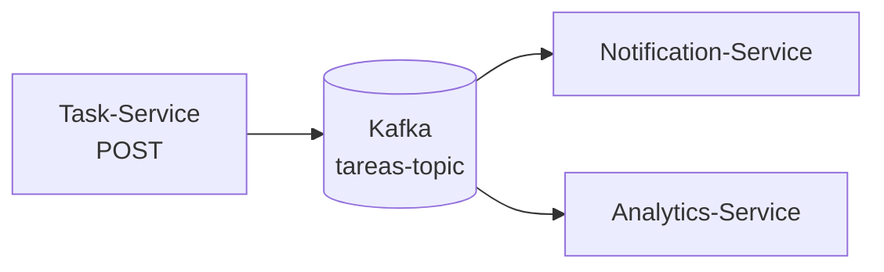

# Informe de Implementación: Sistema de Mensajería Event-Driven

**Grupo 1**

## 1. Introducción

Se implementó una arquitectura basada en eventos utilizando Apache Kafka para desacoplar el proceso de creación de tareas de los servicios de notificación y estadísticas. Esto resuelve el desafío de escalabilidad y mantenibilidad del sistema.

## 2. Stack tecnológico

| Componente | Tecnología |
| --- | --- |
| Backend | Spring Boot (Java 17) |
| Broker | Apache Kafka (modo KRaft) |
| Interfaz de gestión | Kafka UI |
| Orquestación | Docker Compose |

## 3. Arquitectura lograda

- **Productor, Task-Service:** expone una API REST para la creación de tareas y actúa como emisor de eventos.
- **Broker, Apache Kafka:** funciona como bus de mensajería central y persiste los eventos en el tópico `tareas-topic`.
- **Suscriptores:**
  - **Notification-Service:** procesa los eventos para enviar notificaciones al usuario.
  - **Analytics-Service:** procesa los eventos para registrar estadísticas y métricas.

### Flujo de datos

El consumo por parte de ambos servicios se realiza en paralelo.

## 4. Logros técnicos

1. Configuración de una red virtual en Docker que garantiza la comunicación fluida entre los microservicios.
2. Implementación del patrón Pub/Sub con Group IDs independientes, lo que permite el procesamiento paralelo.
3. Resolución de problemas de red en entornos Docker (Advertised Listeners).
4. Automatización de la infraestructura (Infra-as-code) mediante un `docker-compose.yml` completo.
5. Validación del flujo de datos mediante Kafka UI y la terminal de consumo.

## 5. Ventajas arquitectónicas

- **Desacoplamiento:** el emisor no conoce a los receptores.
- **Escalabilidad:** se pueden añadir nuevos consumidores sin modificar el productor.
- **Tolerancia a fallos:** Kafka permite reprocesar eventos mediante offsets.

## 6. Estado actual

Entorno funcional, dockerizado y validado en desarrollo.