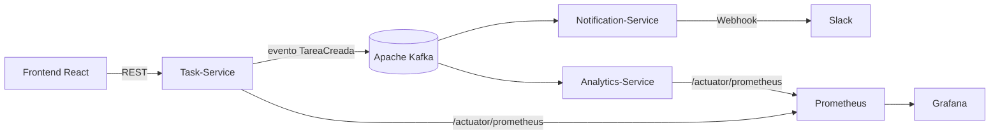
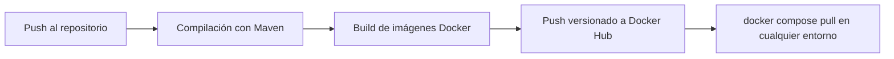

# Informe Final de Proyecto: Plataforma DevOps Event-Driven

|  |  |
| --- | --- |
| **Materia** | \[Nombre de la Materia\] |
| **Grupo** | 1 |
| **Integrantes** | \[Nombres\] |
| **Fecha** | Octubre, 2026 |

---

## 1. Introducción

Este trabajo consiste en el diseño y despliegue de una arquitectura de microservicios basada en eventos (*Event-Driven Architecture*). El sistema resuelve un flujo de creación de tareas (`PedidoCreado` → `TareaCreada`) en el que el productor actúa de forma desacoplada, de modo que múltiples consumidores (Notificaciones y Analíticas) procesan el mismo evento en paralelo.

## 2. Stack tecnológico

| Capa | Tecnologías |
| --- | --- |
| Lenguajes y frameworks | Java 17/21, Spring Boot 3.x, React (Vite + CSS puro) |
| Bus de mensajería | Apache Kafka (modo KRaft) |
| Orquestación y despliegue | Docker, Docker Compose |
| Monitoreo y observabilidad | Prometheus, Grafana, Kafka UI |
| CI/CD | GitHub Actions + Docker Hub |

## 3. Arquitectura del sistema

El sistema se compone de cinco piezas orquestadas en una red virtual común (`devops-net`).

| Componente | Responsabilidad |
| --- | --- |
| **Task-Service** | API REST que se encarga de la persistencia inicial y publica el evento `TareaCreada` en Kafka. |
| **Notification-Service** | Consumidor que procesa el evento y envía notificaciones en tiempo real vía Webhook a Slack. |
| **Analytics-Service** | Consumidor que contabiliza las tareas y expone métricas de negocio para su análisis. |
| **Frontend (React)** | Interfaz moderna y profesional para el usuario final. |
| **Infraestructura** | Kafka (mensajería), Prometheus (recolección de métricas) y Grafana (visualización). |

## 4. Problemas técnicos resueltos

| Problema | Solución aplicada |
| --- | --- |
| **Service discovery y redes virtuales.** El uso de `localhost` impedía la comunicación entre contenedores. | Se creó la red interna `devops-net`, y cada servicio se localiza por su nombre (ej: `kafka:9092`), sin depender de IPs estáticas. |
| **Conflictos de puerto y conectividad.** Aparecían errores `ERR_CONNECTION_RESET`. | Se corrigió el mapeo de puertos host/contenedor y se estabilizaron los `ADVERTISED_LISTENERS`, permitiendo acceso interno (Docker) y externo (Kafka UI). |
| **Integración de observabilidad.** Prometheus devolvía `404 Not Found`. | Se reconfiguró el `scrape_path` hacia `/actuator/prometheus` (endpoint estándar de Spring Boot Actuator) y se configuró Micrometer para exponer métricas personalizadas (`tareas_procesadas_total`). |
| **Desacoplamiento de eventos.** Los consumidores competían por los mensajes. | Se asignaron `group-id` únicos a cada consumidor, de modo que el mensaje llega a todos los suscriptores. |

## 5. Pipeline de CI/CD

Para garantizar calidad y entrega continua, se implementó un pipeline en GitHub Actions.

1. **Integración:** compilación del código fuente con Maven.
2. **Containerización:** construcción automática de la imagen Docker de cada servicio.
3. **Entrega continua:** push automático de las imágenes versionadas a Docker Hub, para que cualquier entorno (dev, test o prod) despliegue la última versión con un simple `docker compose pull`.

## 6. Monitoreo y dashboarding

Se integró un stack de observabilidad que permite:

- **Monitoreo en tiempo real:** comparar métricas de negocio (tareas procesadas) con métricas de infraestructura (latencia de respuesta HTTP) en paneles de Grafana.
- **Throughput de eventos:** usar funciones `rate()` de Prometheus para graficar la velocidad de procesamiento e identificar picos de carga.

## 7. Conclusión

El proyecto permitió validar la robustez del patrón Pub/Sub. La arquitectura es resiliente y escalable: ante la caída de un servicio, Kafka retiene los mensajes hasta que el consumidor vuelve a estar operativo. La automatización del pipeline y la observabilidad completan un ciclo de vida DevOps profesional, listo para ser desplegado en entornos productivos.